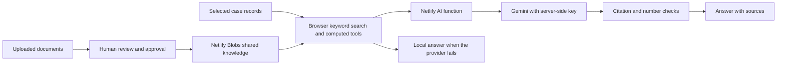

# Using and checking the AI assistant

The assistant searches the records of the plant shown in the app. It uses those records and the built-in calculation tools to answer questions. With a working server connection, Gemini writes the answer. Without that connection, the app answers from its local records and shows a search-only label. A local answer does not prove that Gemini works.

Open each cited source before using a safety-critical value. Check its revision and approval status. Confidence scores and predictive results are screening estimates, not approval to operate. The assistant refuses requests for instructions to bypass trips or interlocks.

## Connect Gemini

An administrator can set `AI_API_KEY` in the Netlify site's environment settings and redeploy. Start with `AI_PROVIDER=gemini`. `AI_MODEL` selects the first model; `AI_MODEL_FALLBACK` lists alternatives separated by commas. The current defaults try Flash models. Availability and quota depend on the account and can change.

Alternatively, set `ADMIN_CODE` on Netlify and redeploy. In the app, open Settings, enter the administrator code under Access codes, then enter the key under Connect the AI and choose Save and test. A saved key takes priority over the environment key. Remove the saved key to return to the environment key. Enter keys only in these secure settings, never in chat, source files, screenshots or handoff notes.

## Check the connection

1. Open Settings and select Test the AI connection. A Working message confirms that the app received an answer through its configured provider. The full assistant request is used for this check.
2. Select Run diagnostics. Shared storage checks whether server-side records can be saved and read. Provider connection checks the model list. A listed model is not proof that it will answer.
3. Read AI answer. This makes a small real request and reports which model returned visible text, or why the attempts failed. Empty output, hidden reasoning alone, a blocked response and malformed JSON do not count as answers. Each upstream operation has a 1.5 s limit and the whole diagnostic has a 6 s limit to leave deployment overhead. A slow diagnostic can fail even when a longer normal request would work.
4. Ask a normal plant question and open its sources. Confirm the label says AI connected and the answer names the model. Check that sources belong to the selected plant.

Diagnostics also support an OpenAI compatible provider. A test provider is labelled as a test and does not establish a real Gemini connection. Diagnostics are not an embeddings test or a guarantee that a full question will complete.

## Read a failure

| Message | What to check |
|---|---|
| No AI key on the server | Add the key in Netlify and redeploy, or use Connect the AI with the administrator code. |
| HTTP 400, 401 or 403 | Check the provider, key, API restrictions and request error. Trying another model cannot repair a rejected key. |
| Model not found or HTTP 404 | Check `AI_MODEL`. The assistant tries configured alternatives and can discover available Gemini models. |
| HTTP 429 or quota exceeded | Check account quota and billing restrictions. A different model may have quota; repeated retries cannot create quota. |
| HTTP 500, 502, 503 or 504 | Read the accompanying provider message. Retry once and check the provider status. A Netlify crash page needs function logs. |
| No answer text or SAFETY | The provider returned no visible answer. Do not treat the model-list check as success. |
| Diagnostics time limit | Retry once. If it repeats, check Netlify function logs and select a faster model. Diagnostics report partial completed checks. |
| Search by meaning stays loading | This concerns embeddings, a separate service with its own model and quota. Keyword search can still work. Report the embedding error from the browser or function logs. |
| Search only (AI not reachable) | The app fell back to records. Read Test the AI connection and Run diagnostics for the underlying cause. |

When reporting a problem, share the failing check name, its message, model name, approximate time and whether it happened after redeployment. Remove keys, access codes and private plant text from logs before sharing. Do not send a key to an agent.

## A different plant tomorrow

The integrator adds the new case pack and builds it. The assistant sends that case's title and retrieved records to the server. Check a known equipment question, a question the records cannot answer and a bypass request on the new case. Confirm citations, approval warnings, numeric values and the refusal. Never fill gaps with figures from the previous plant.

## Developer checks and current verification

From the repository root, run `bash tools/setup_env.sh`, `python3 build.py`, `npm run test:quick` and `node tests/live.js`. Set `CHROMIUM` to the installed browser, `/usr/bin/chromium` in this cloud environment. Browser and local-server commands here need command sandbox escalation. The live test uses local fake providers and HTTP, including diagnostics failure cases and the original plant's 131-question evaluation. It cannot prove live Gemini access.

This cloud browser blocks file URLs, so the shared regression runner in `npm run test:quick` cannot navigate to its build here. That runner needs an HTTP route from its owner. No administrator browser policy is disabled. The live suite remains the HTTP-based assistant check. Claude A must merge `codex/ai` and redeploy before these changes reach the live site. A human must then run the connection and diagnostics checks above; no real Gemini key was available for local validation.

## Recovery from retired or overloaded models

The assistant gives each Gemini model up to 3 s to start returning text, within an 8 s provider-call budget. After two retryable failures it asks the provider for currently available models before spending time on more configured aliases. Authentication errors stop retries. Once text starts, the request can continue until the overall deadline; a streaming error discards the partial answer and uses the local records. These are application timers, not a guarantee of wall time on a paused or overloaded worker.

A model listed by the key can still be retired for new users or have no usable quota. Do not assume a replacement name from a truncated provider error. Read the current model list or a successful connection test. If diagnostics still say "key accepted, 50 models visible" and "no answer within 5 s", that response is from the earlier diagnostic implementation. Claude A must merge this branch and deploy the resulting main commit to the production site before these fixes can be checked there.

## Connection plan for the hackathon

Keep the existing architecture for tomorrow. The supplied failures occur at model calls, while shared storage and the API key checks succeed. Replacing the database would not resolve a retired model or provider overload.

The system uses retrieval, not model training. Adding a document makes its reviewed content searchable; it does not retrain Gemini or guarantee that every uploaded statement is correct. The existing case pack holds plant records, Netlify Blobs holds shared knowledge and server settings, and embeddings help find relevant text. Keyword search must remain usable when embeddings fail. Keep synthetic examples separate from the real case and verify every safety-critical value against an approved source.

Before the demo:

1. Claude A merges the latest `codex/ai` and deploys the production site from main. In Netlify, confirm the successful deploy's commit and production URL, rather than a branch preview URL.
2. Open `/api/health` on that exact site. The updated endpoint includes `deployment.commit` and `deployment.ai_revision` (`model-recovery-2`). Compare the commit with Netlify's deployed commit. A missing revision means the endpoint is older than this update. A null commit means the build environment did not supply `COMMIT_REF`; use Netlify's deploy details to identify it.
3. Open Settings and run Test the AI connection and Run diagnostics. A configured key or model-list success alone is insufficient. Record the model that actually answered and any failed attempt message. Do not copy the key.
4. Check Search by meaning. The updated Settings shows an embedding error instead of indefinite loading. It also states that keyword search remains usable. OpenAI compatible providers do not advertise this Gemini-only embedding endpoint.
5. On the real case, ask one question with a known documented answer, one maintenance calculation, one question absent from the records and one unsafe bypass request. Open the citations and compare the answer with the real-case documents. The absent answer must identify the missing evidence and the unsafe request must be refused.
6. Add one non-critical test knowledge item, review and approve it, then confirm a second browser can retrieve it. Remove that test item after checking. This verifies shared knowledge, independently of model availability.

If the live site still fails after these checks, send the production URL, `deployment.commit`, `deployment.ai_revision`, the connection-test message and all diagnostic check messages, with credentials removed. These identify whether the next fix belongs to deployment, key restrictions, model availability, provider quota or embeddings. The local fake-provider tests cannot establish that a particular real Gemini model will answer tomorrow.

The server embedding cache now separates provider, endpoint, model and retrieval task. Identical text sent as a question can no longer reuse a document embedding by mistake. Existing browser-side embedding caches can still need a refresh when the model or provider changes; keep `AI_EMBED_MODEL` stable during the demo and report any model change before reusing stored vectors.

Diagnostics now discover available models after two failed configured attempts, matching the normal assistant's recovery order. The JSON includes `attempts` with each model name, whether it answered and its result; a deadline response retains completed and currently running attempts. Flash Lite ranks ahead of Pro among discovered alternatives to avoid prioritising a heavier Pro model over a lightweight fallback. The provider model list still does not guarantee quota or successful generation.

For tomorrow's different plant, follow `docs/NETLIFY_MULTI_CASE.md` and use a separate Netlify site and its storage. Preserve the original plant's site and records. This keeps old shared knowledge and saved settings from being mistaken for the new plant's evidence. Verify the new case title and equipment tags before uploading or approving documents.

## SPI Vercel: database to forecast chart

Open Forecast, search for a material and select it. Read evidence and plan this part requests `/api/ai/plan`. The database evidence is passed to mock/rules reasoning by default, or Gemini when `AI_PROVIDER=gemini` and `AI_API_KEY` are set securely in Vercel. Set `AI_MODEL` only to a model available to the account. Redeploy after changing the environment. Open `/api/ai/health` to see provider, key presence, responding model, last error and deployment commit; a mock success explicitly does not verify Gemini.

The model proposes a bounded plan. A validator checks it before the deterministic forecasting engine computes numbers. The candidate is compared with the rules baseline before adoption. Forecast shows the selected method and provider, an evidence/validation/backtest trace, the historical series, and the engine's p10, p50 and p90 predictions in both a chart and a table. Accepting a proposed driver sends a new request and redraws from its new engine result; rejected and unaccepted AI proposals do not silently change the plotted forecast. Driver effects are scenarios, not proven future events.

For the complete path, Claude A must merge both Codex Fin's `spi/engine` and Codex AI's endpoint/page changes before deploying. If the engine has not been merged, the page displays its validated reasoning plan and an explicit unavailable message rather than invented prediction values. Vercel needs both SQLite files required by the app's configured deployment; interactive requests do not write to SQLite. The existing Netlify site remains separate, and its synchronization requests are suppressed in SPI mode.

Verification: `AI_PROVIDER=mock node tests/spi_ai.js` checks the reasoning core; `node tests/spi_ai_api.js` checks the API; `AI_PROVIDER=mock node tests/spi_ai_engine_integration.js` exercises all fixture parts against the real merged engine. Build the SPI page, then run `CHROMIUM=/usr/bin/chromium node tests/spi_ui_ai_flow.js` to verify the chart transport and accepted-input redraw. This last test uses the real merged engine and a synthetic reasoning provider by default. `SPI_TEST_ENGINE=/absolute/path/to/published/spi/engine/index.js` tests a published real engine candidate; `SPI_SYNTHETIC_ENGINE=1` explicitly enables an isolated synthetic-engine transport check. The tests never call real Gemini or establish live Vercel success.

### Vercel key setup for SPI

Open Vercel, select the SPI project, then Settings > Environment Variables. Add `AI_PROVIDER` with value `gemini`, `AI_API_KEY` with Sensitive enabled, and `AI_MODEL` with value `gemini-flash-latest`. Select the Production and Preview environments used by the deployment URL. Save, then open Deployments, select the deployment menu and choose Redeploy. Open `/api/ai/health` on the resulting URL and inspect `ok`, provider, model, key presence, last error and deployed commit. Never paste the key into chat. If this model fails, share the error and attempt results so an available model can be chosen.

All SPI AI handlers live under `server/ai/` and are dispatched through the single `api/router.mjs` function. Public URLs remain `/api/ai/health`, `/api/ai/plan` and `/api/ai/ask`. Do not create additional functions under `api/`.

### Ask the AI in SPI

Open Ask the AI and ask an inventory question or include a material number. Sources and tool steps show which baseline records were read. Mock mode uses rules and SQL without contacting a model. Gemini may read additional bounded tools and propose forecast adjustments. Proposals appear with Accept and Reject. Accept validates the adjustment again, reruns the engine and updates the selected forecast chart. A provider failure uses the available database answer and explains the reason in the tool steps. A connection failure is shown in plain words.

Baseline cautions: procurement lead time is a proxy from PR date to PO delivery date. Criticality order S, A, B, C is assumed. Inventory position is on-hand only. Monetary values are Estimates. Synthetic baseline records do not establish future events.

### Offline batch results

Run `AI_PROVIDER=mock node spi/ai/batch.js` from the repository root to create or resume `spi/db/results.sqlite`. The baseline database remains read-only. Every material is processed in material-number order; parts with demand or S/A criticality use the configured provider, and the remaining portfolio uses rules. If a key is present securely in the process environment, omit `AI_PROVIDER=mock` to use Gemini for eligible parts. Never put the key in a command, source file or chat. `SPI_BATCH_LIMIT` limits a trial run; `--eligible-only` processes only the eligible set. The same command resumes completed parts. Changed baseline data, code or provider settings start a separate batch identity.

Each part is committed atomically with its reasoning, proposed inputs, selected plan, forecast, inventory and recommendation. Other batches and portfolio rows are retained. Progress includes input and output tokens. Failed provider calls may have unknown token usage, which is labelled incomplete. No monetary API cost is inferred. Run with the human's securely configured key at M3 and M5; mock results do not verify Gemini availability.

### Published mock snapshot and deployment

The combined AI and Codex Fin snapshot is published as `spi/ai/results.sqlite.gz` because the full SQLite file exceeds GitHub's single-file limit. Claude A must run `node spi/ai/restore_results.js` before Vercel packages the function. It verifies the baseline and file checksums, then creates `spi/db/results.sqlite`. An existing different results file is protected; preserve or merge it before restoring. `spi/ai/results_manifest.json` records the source, counts and mock-only status. This snapshot covers all 7,481 baseline materials and does not verify real Gemini.

The health response includes `one_word_result: "READY"` only after a valid model response (or the explicitly labelled mock response). Check this field with the responding model and deployed commit, rather than treating key presence as a successful AI connection.

### Follow-up questions and chart answers

Try `Describe material 4100000129`, then `Show its last 6 months of consumption`, then `Now forecast it`. The assistant retains that material for the follow-up. Naming another material or equipment tag changes the context. The page can also pass the selected material. Context selects read-only tools; it never changes database records.

History, on-hand/Min/Max, matching-material issue counts, location indicators, campaigns, maintenance, savings and portfolio counts use chart values taken directly from tool results. Rules value projections are labelled Estimates and cover priced parts only. Material forecast lines and p10 to p90 bands come from the deterministic engine. The model cannot supply plotted numbers. Accepting a proposed adjustment validates it again and reruns the engine before redrawing. A missing value is not replaced with an invented zero.

The old assistant panel uses the same service, normalises its chat history and supports its Stop action. Its footer identifies the provider used for the last answer. A working mock or rules answer does not verify Gemini. Database descriptions and notification text are untrusted source material; they are not instructions to the assistant. This is retrieval and reasoning over the database, not model training.

### Financial questions

The assistant can call Finance's deterministic tools for cleanup NPV, recurring cash balance, inventory budgets, availability funding, policy validation and candidate ranking. Try `What share is required for cleanup NPV break-even?` or `How much inventory budget for A parts if demand rises 20%?`. Explicit scenario changes are Assumptions. Positive NPV and positive recurring cash are separate tests. Funding thresholds are not claimed benefits, and no missing plant contribution margin is invented. Source IDs identify the exact scenario.

Answers and forecasts use the shared visual kit, with units on axes and evidence/value tables behind expandable controls. The Forecast page shows its loading state immediately and ignores delayed responses from a previously selected material.

The assistant also checks explicit financial assumptions in ordinary wording, such as `realise 15%`, `half the cleanup scope`, `annual solution costs are IDR 200000000`, `receipt lead is 20% longer`, and `three candidates`. These values are sent to the calculator and remain labelled scenario Assumptions. Financial replies preserve the calculator's numbers and interpretation; project NPV and recurring annual cash are shown separately. Thresholds and missing values retain their meanings. Full interpretation and source IDs are available behind the expandable controls.

## Scenario simulator

Open **Forecasting and Simulation > Scenario simulator**. This calculator works without an AI key. It uses the database's material profiles and Finance's immutable forecast and policy batch. It does not write to the database, place an order or approve disposal.

1. Select all parts, a criticality, item type, system, equipment, material number or description search. Filters intersect. The page shows the number of matched materials, priced coverage, source fingerprint and cut-off.
2. Choose a starting scenario or adjust stock, demand, lead time, purchase price and reorder policy. Twelve starters cover stock reduction, maintenance surge, additional shutdown demand, supplier delay, receipt freeze, warehouse damage, inflation, commissioning, retirement, compound disruption and explicitly hypothetical alternative supply.
3. Add up to 30 timed events. Set the first and last active month and optional material, criticality and item-type targets. Demand and price multipliers compound. A stock-loss event occurs once at its first month. One-off demand applies once per active month; use the same first and last month for a single incident. Extra maintenance demand equals extra jobs per targeted material per month times the explicit spare-use probability times units per job. Notification counts alone are not a consumption forecast. Unmatched events are flagged.
4. Read economic cost, cash funding, demand fill, shortfall part-months, stock trajectory, cumulative funding and the cost breakdown. Monetary figures are Estimates for priced parts. Expand material outcomes or chart data to search the detailed tables. Different physical units are not summed into an invented plant-wide quantity.
5. Set overall and critical demand-fill floors and an optional peak cumulative cash funding cap. Choose economic cost, operating cost or cash funding as the search objective. Click **Find lower-cost plan**. The search tests combinations of current, dynamic and workbook policies, stock levels and Min/Max scales under the same shocks and assumptions. It returns the least-cost feasible tested candidate, or explicitly says none is feasible. It does not claim a global optimum. You can stop the search or keep editing. Apply a tested plan to replay it, then review individual affected parts with maintenance and procurement.
6. Save up to four scenarios in this browser, replay them on the current selected scope, or export inputs and outcomes as JSON and monthly results as CSV. A saved scenario can restore its original scope. Import validates inputs and recomputes results instead of trusting figures in the file. A different source fingerprint is flagged. Never compare totals over different horizons without checking the assumptions.

### Cost and physical limits

The shared model uses four expected-flow steps per month. It is a deterministic inventory stress test, not a calibrated probability or production-network model. Shaded demand sensitivity is not a confidence interval. Recorded campaign effects are already in the baseline forecast; added events are incremental Assumptions. Beyond the available forecast horizon, the last available forecast month is repeated as an Assumption.

Opening stock is a prepositioned starting-state Assumption. Increases are purchased and funded at time zero; they do not imply immediate supplier delivery. Voluntary cuts protect critical and insurance reserves and flagged Non Stock or Max 0 materials. Physical damage can explicitly destroy those reserves. Zero observed demand does not mean zero need. Opening purchase pipeline and backorders are Not in baseline data; the simulator starts with no existing purchase pipeline, tracks new orders and records unfilled demand rather than inventing backorders.

Lead time is a PR-to-PO-delivery proxy, or a labelled pooled planning Assumption when absent. Stock is counted once per material. Prices are unit-price Estimates; missing prices remain unknown. New prices affect purchases, not the value of existing inventory. Expedite capacity, alternative supply, recovery fraction, order fee and shortfall penalty require human confirmation. Shortfall penalty is a unit-value proxy, not measured downtime loss.

Economic cost includes consumption, economic holding, order fees, expedite fees, write-offs and the selected shortfall penalty. Cash funding includes purchase payments, cash holding, order/expedite fees and hypothetical stock recovery. Purchase principal is not counted again as an economic expense; economic and cash holding are separate views. A cost comparison does not establish a real recoverable saving. A cash cap cannot be verified if required prices are missing.

The same dependency-free model runs in a browser worker and on the server. `/api/ai/scenario` supplies the catalogue, a parameterised read-only selected source and validated server replay. It stays behind the existing single Vercel router. No extra function or API key is needed. Arbitrary free text, SQL and executable scenario files are not accepted. Processes outside the supported event types need additional data and an appropriate engineering model.

A scope selects distinct materials. Their stock and demand remain plant-wide totals per material, including shared spares. Equipment-specific consumption allocation is Not in baseline data. The current baseline also lacks system-to-material BOM mappings, so unsupported system choices are not offered and no equipment mapping is guessed from tag names. Supplier lead-delay events affect new simulated orders; use receipt availability to stress due shipments as well.
