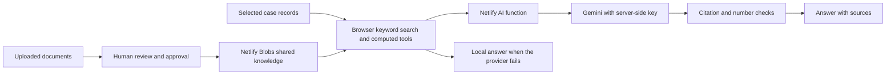

# Using and checking the AI assistant

The assistant searches the records of the plant shown in the app. It uses those records and the built-in calculation tools to answer questions. With a working server connection, Gemini writes the answer. Without that connection, the app answers from its local records and shows a search-only label. A local answer does not prove that Gemini works.

Open each cited source before using a safety-critical value. Check its revision and approval status. Confidence scores and predictive results are screening estimates, not approval to operate. The assistant refuses requests for instructions to bypass trips or interlocks.

## Connect Gemini

An administrator can set `AI_API_KEY` in the Netlify site's environment settings and redeploy. Start with `AI_PROVIDER=gemini`. `AI_MODEL` selects the first model; `AI_MODEL_FALLBACK` lists alternatives separated by commas. The current defaults try Flash models. Availability and quota depend on the account and can change.

Alternatively, set `ADMIN_CODE` on Netlify and redeploy. In the app, open Settings, enter the administrator code under Access codes, then enter the key under Connect the AI and choose Save and test. A saved key takes priority over the environment key. Remove the saved key to return to the environment key. Enter keys only in these secure settings, never in chat, source files, screenshots or handoff notes.

## Check the connection

1. Open Settings and select Test the AI connection. A Working message confirms that the app received an answer through its configured provider. The full assistant request is used for this check.
2. Select Run diagnostics. Shared storage checks whether server-side records can be saved and read. Provider connection checks the model list. A listed model is not proof that it will answer.
3. Read AI answer. This makes a small real request and reports which model returned visible text, or why the attempts failed. Empty output, hidden reasoning alone, a blocked response and malformed JSON do not count as answers. Each upstream operation has a 1.5 s limit and the whole diagnostic has a 6 s limit to leave deployment overhead. A slow diagnostic can fail even when a longer normal request would work.
4. Ask a normal plant question and open its sources. Confirm the label says AI connected and the answer names the model. Check that sources belong to the selected plant.

Diagnostics also support an OpenAI compatible provider. A test provider is labelled as a test and does not establish a real Gemini connection. Diagnostics are not an embeddings test or a guarantee that a full question will complete.

## Read a failure

| Message | What to check |
|---|---|
| No AI key on the server | Add the key in Netlify and redeploy, or use Connect the AI with the administrator code. |
| HTTP 400, 401 or 403 | Check the provider, key, API restrictions and request error. Trying another model cannot repair a rejected key. |
| Model not found or HTTP 404 | Check `AI_MODEL`. The assistant tries configured alternatives and can discover available Gemini models. |
| HTTP 429 or quota exceeded | Check account quota and billing restrictions. A different model may have quota; repeated retries cannot create quota. |
| HTTP 500, 502, 503 or 504 | Read the accompanying provider message. Retry once and check the provider status. A Netlify crash page needs function logs. |
| No answer text or SAFETY | The provider returned no visible answer. Do not treat the model-list check as success. |
| Diagnostics time limit | Retry once. If it repeats, check Netlify function logs and select a faster model. Diagnostics report partial completed checks. |
| Search by meaning stays loading | This concerns embeddings, a separate service with its own model and quota. Keyword search can still work. Report the embedding error from the browser or function logs. |
| Search only (AI not reachable) | The app fell back to records. Read Test the AI connection and Run diagnostics for the underlying cause. |

When reporting a problem, share the failing check name, its message, model name, approximate time and whether it happened after redeployment. Remove keys, access codes and private plant text from logs before sharing. Do not send a key to an agent.

## A different plant tomorrow

The integrator adds the new case pack and builds it. The assistant sends that case's title and retrieved records to the server. Check a known equipment question, a question the records cannot answer and a bypass request on the new case. Confirm citations, approval warnings, numeric values and the refusal. Never fill gaps with figures from the previous plant.

## Developer checks and current verification

From the repository root, run `bash tools/setup_env.sh`, `python3 build.py`, `npm run test:quick` and `node tests/live.js`. Set `CHROMIUM` to the installed browser, `/usr/bin/chromium` in this cloud environment. Browser and local-server commands here need command sandbox escalation. The live test uses local fake providers and HTTP, including diagnostics failure cases and the original plant's 131-question evaluation. It cannot prove live Gemini access.

This cloud browser blocks file URLs, so the shared regression runner in `npm run test:quick` cannot navigate to its build here. That runner needs an HTTP route from its owner. No administrator browser policy is disabled. The live suite remains the HTTP-based assistant check. Claude A must merge `codex/ai` and redeploy before these changes reach the live site. A human must then run the connection and diagnostics checks above; no real Gemini key was available for local validation.

## Recovery from retired or overloaded models

The assistant gives each Gemini model up to 3 s to start returning text, within an 8 s provider-call budget. After two retryable failures it asks the provider for currently available models before spending time on more configured aliases. Authentication errors stop retries. Once text starts, the request can continue until the overall deadline; a streaming error discards the partial answer and uses the local records. These are application timers, not a guarantee of wall time on a paused or overloaded worker.

A model listed by the key can still be retired for new users or have no usable quota. Do not assume a replacement name from a truncated provider error. Read the current model list or a successful connection test. If diagnostics still say "key accepted, 50 models visible" and "no answer within 5 s", that response is from the earlier diagnostic implementation. Claude A must merge this branch and deploy the resulting main commit to the production site before these fixes can be checked there.

## Connection plan for the hackathon

Keep the existing architecture for tomorrow. The supplied failures occur at model calls, while shared storage and the API key checks succeed. Replacing the database would not resolve a retired model or provider overload.

The system uses retrieval, not model training. Adding a document makes its reviewed content searchable; it does not retrain Gemini or guarantee that every uploaded statement is correct. The existing case pack holds plant records, Netlify Blobs holds shared knowledge and server settings, and embeddings help find relevant text. Keyword search must remain usable when embeddings fail. Keep synthetic examples separate from the real case and verify every safety-critical value against an approved source.

Before the demo:

1. Claude A merges the latest `codex/ai` and deploys the production site from main. In Netlify, confirm the successful deploy's commit and production URL, rather than a branch preview URL.
2. Open `/api/health` on that exact site. The updated endpoint includes `deployment.commit` and `deployment.ai_revision` (`model-recovery-2`). Compare the commit with Netlify's deployed commit. A missing revision means the endpoint is older than this update. A null commit means the build environment did not supply `COMMIT_REF`; use Netlify's deploy details to identify it.
3. Open Settings and run Test the AI connection and Run diagnostics. A configured key or model-list success alone is insufficient. Record the model that actually answered and any failed attempt message. Do not copy the key.
4. Check Search by meaning. The updated Settings shows an embedding error instead of indefinite loading. It also states that keyword search remains usable. OpenAI compatible providers do not advertise this Gemini-only embedding endpoint.
5. On the real case, ask one question with a known documented answer, one maintenance calculation, one question absent from the records and one unsafe bypass request. Open the citations and compare the answer with the real-case documents. The absent answer must identify the missing evidence and the unsafe request must be refused.
6. Add one non-critical test knowledge item, review and approve it, then confirm a second browser can retrieve it. Remove that test item after checking. This verifies shared knowledge, independently of model availability.

If the live site still fails after these checks, send the production URL, `deployment.commit`, `deployment.ai_revision`, the connection-test message and all diagnostic check messages, with credentials removed. These identify whether the next fix belongs to deployment, key restrictions, model availability, provider quota or embeddings. The local fake-provider tests cannot establish that a particular real Gemini model will answer tomorrow.

The server embedding cache now separates provider, endpoint, model and retrieval task. Identical text sent as a question can no longer reuse a document embedding by mistake. Existing browser-side embedding caches can still need a refresh when the model or provider changes; keep `AI_EMBED_MODEL` stable during the demo and report any model change before reusing stored vectors.

Diagnostics now discover available models after two failed configured attempts, matching the normal assistant's recovery order. The JSON includes `attempts` with each model name, whether it answered and its result; a deadline response retains completed and currently running attempts. Flash Lite ranks ahead of Pro among discovered alternatives to avoid prioritising a heavier Pro model over a lightweight fallback. The provider model list still does not guarantee quota or successful generation.

For tomorrow's different plant, follow `docs/NETLIFY_MULTI_CASE.md` and use a separate Netlify site and its storage. Preserve the original plant's site and records. This keeps old shared knowledge and saved settings from being mistaken for the new plant's evidence. Verify the new case title and equipment tags before uploading or approving documents.
